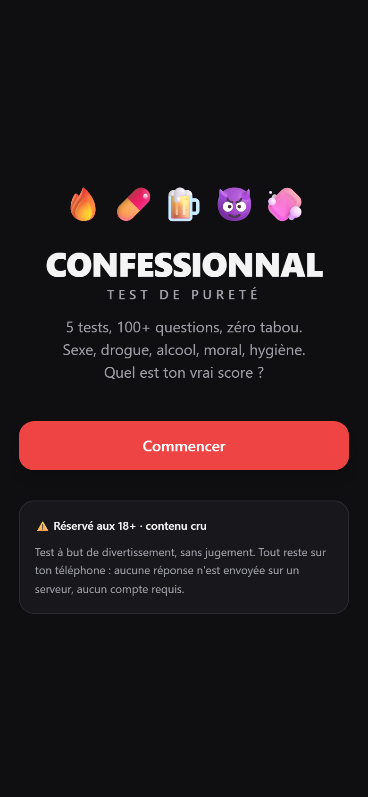
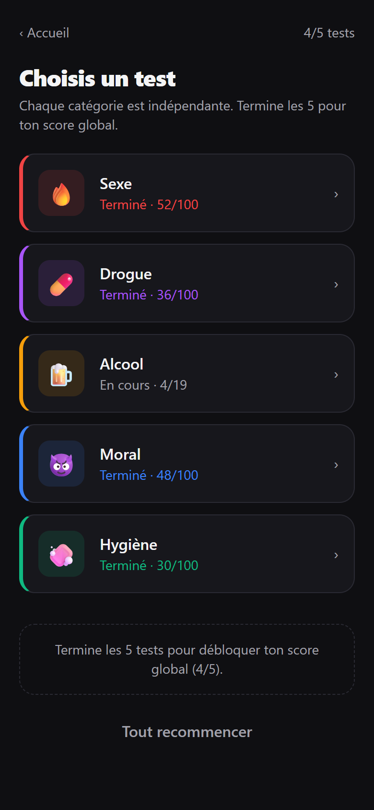
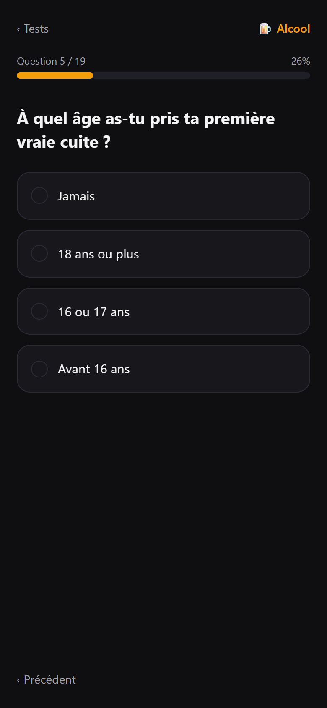
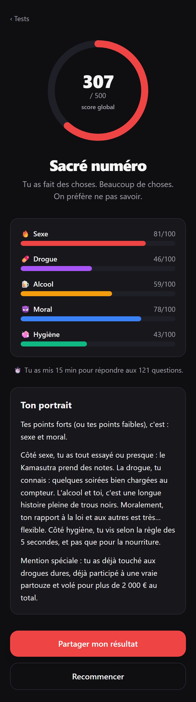

# Confessionnal — Purity Test

Mobile-first web app (PWA) — an **experience test** across 5 independent
categories: sex, drugs, alcohol, morals, hygiene. Weighted multiple-choice
quiz, raw and unfiltered tone. **High = experienced**, low = innocent.

100% client-side: no data is sent, no account. Progress is saved in
`localStorage` and sharing works through an encoded link.

▶️ [Try it online](https://floran-grmxx.github.io/purity-test/)

## Screenshots

<p align="center">
  
  
  
  
</p>

## Scoring

- Each category: `points obtenus / points max × 100` → **/100**.
- Overall score: sum of the 5 categories → **/500**.
- A profile title is assigned based on the overall range.

## Stack

React 19 · Vite 6 · TypeScript · Tailwind CSS v4 · React Router (HashRouter) ·
vite-plugin-pwa · Vitest.

## Commands

```bash
npm install        # installer les dépendances
npm run dev        # serveur de dev
npm run build      # build de production (dist/)
npm run preview    # servir le build
npm test           # tests unitaires + intégrité données + smoke render
npm run typecheck  # vérification TypeScript
```

## Structure

```
src/
  data/         types, catégories, banques de questions + prérequis logiques
  lib/          scoring, storage (localStorage), share (encode URL)
  state/        QuizContext (état + persistance)
  components/   ProgressBar, ScoreRing, CategoryBar, CategoryCard, Button, Page
  screens/      Home, Hub, Quiz, CategoryResult, GlobalResult, SharedResult
```

## Deployment

Static build (`dist/`) deployable on Vercel / Netlify / GitHub Pages.
The app uses `HashRouter`, so no server rewrite config is needed.
For GitHub Pages under a subpath, set `base` in `vite.config.ts`.

## Disclaimer

Adults only (18+), for entertainment purposes, no judgment.
