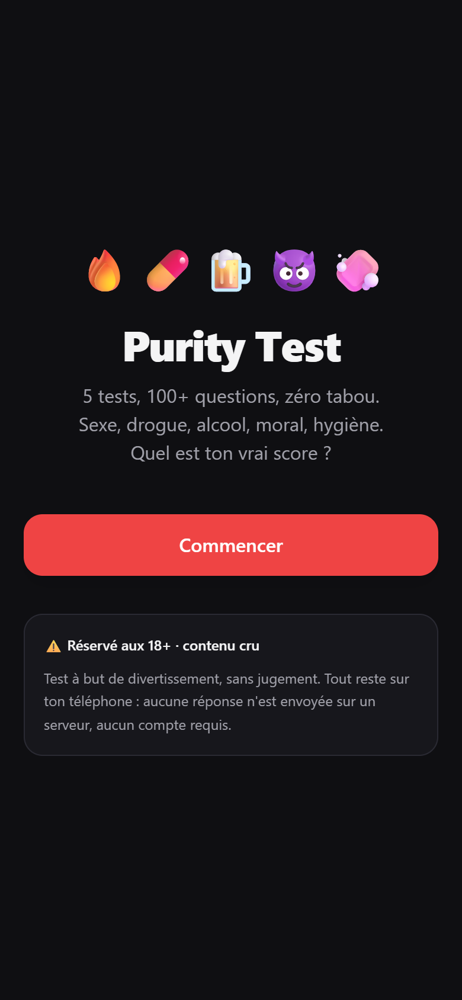
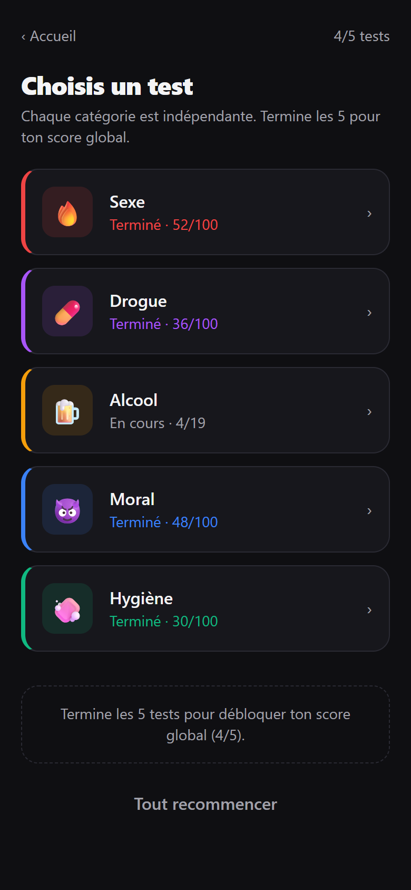
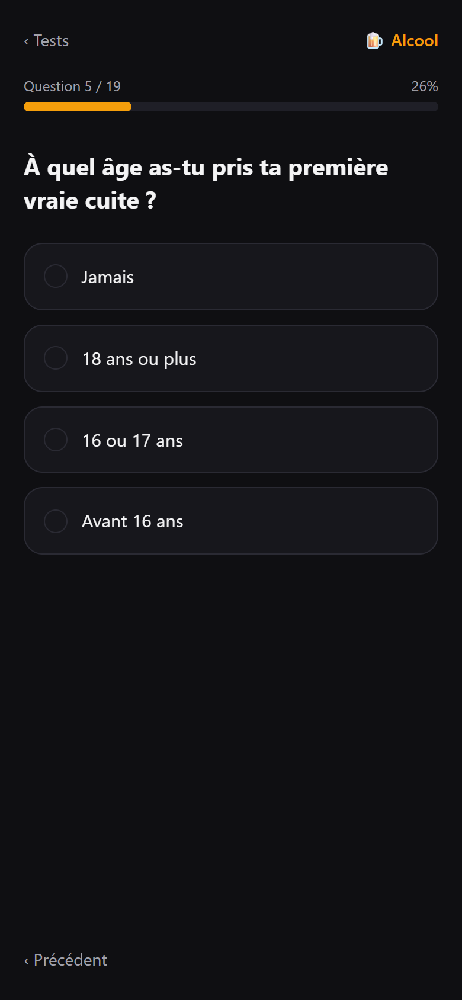
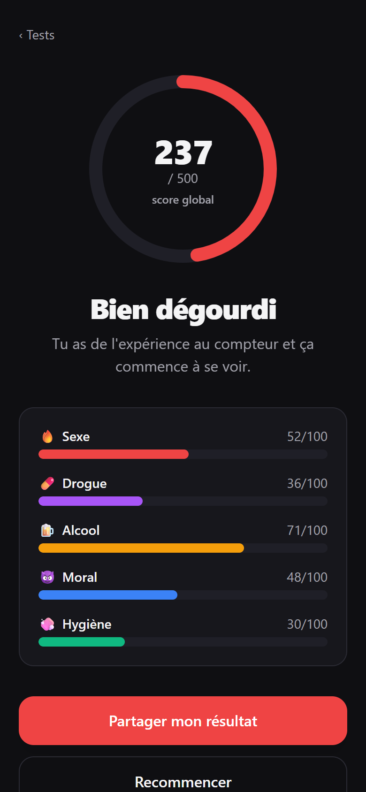

# Purity Test

Web app mobile-first (PWA) — un **test d'expérience** en 5 catégories
indépendantes : sexe, drogue, alcool, moral, hygiène. QCM pondéré, ton cru et
sans tabou. **Haut = expérimenté**, bas = innocent.

100 % côté client : aucune donnée n'est envoyée, aucun compte. La progression
est sauvegardée en `localStorage` et le partage passe par un lien encodé.

▶️ [Essayer en ligne](https://floran-grmxx.github.io/purity-test/)

## Captures

<p align="center">
  
  
  
  
</p>

## Scoring

- Chaque catégorie : `points obtenus / points max × 100` → **/100**.
- Score global : somme des 5 catégories → **/500**.
- Un titre de profil est attribué selon la tranche globale.

## Stack

React 19 · Vite 6 · TypeScript · Tailwind CSS v4 · React Router (HashRouter) ·
vite-plugin-pwa · Vitest.

## Commandes

```bash
npm install        # installer les dépendances
npm run dev        # serveur de dev
npm run build      # build de production (dist/)
npm run preview    # servir le build
npm test           # tests unitaires + intégrité données + smoke render
npm run typecheck  # vérification TypeScript
```

## Structure

```
src/
  data/         types, catégories, banques de questions (20 × 5)
  lib/          scoring, storage (localStorage), share (encode URL)
  state/        QuizContext (état + persistance)
  components/   ProgressBar, ScoreRing, CategoryBar, CategoryCard, Button, Page
  screens/      Home, Hub, Quiz, CategoryResult, GlobalResult, SharedResult
```

## Déploiement

Build statique (`dist/`) déployable sur Vercel / Netlify / GitHub Pages.
L'app utilise `HashRouter`, donc aucune config de réécriture serveur n'est
nécessaire. Pour GitHub Pages dans un sous-chemin, définir `base` dans
`vite.config.ts`.

## Avertissement

Contenu réservé aux adultes (18+), à but de divertissement, sans jugement.
